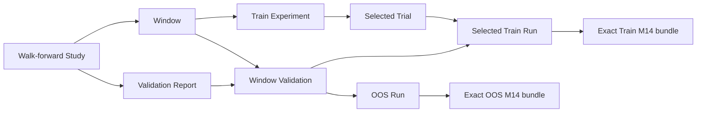

# M16.2.2 Research Integrity Closeout

## Scope and decision

This closeout strengthens the optional M16.2 chat runtime without adding tools, changing
M13-M15 calculations, or enabling writes to research artifacts. The server now proves
TRAIN/OOS ownership from persisted M15 artifacts, derives independent-backtest comparison
contracts from exact M14 bundles, and renders qualitative inference from controlled
templates.

No `0050` migration is needed. The existing assistant-message `metadata_json` already
stores structured claims and citations, while the existing M15 tables already provide the
required composite foreign keys and append-only artifacts. New fields are optional, so
historical messages remain readable.

## Persisted lineage



`ExperimentLineageResolver` accepts only `performance.summary` facts for each window-side
endpoint. It verifies:

- the Validation Report owns the Study and Window Validation;
- Window, Experiment, Evaluation, selected Trial and selected rank-one Run agree;
- Train and OOS Performance reports belong to their exact Runs;
- persisted PerformanceDaily date sets and report periods equal the frozen Window dates;
- an optional `walk_forward.summary` identity pins one Validation Report, but its aggregate
  OOS values never substitute for a window-level OOS Performance fact.

The result is `VERIFIED`, `UNVERIFIABLE`, or `MISMATCH`. Missing historical lineage is
unverifiable rather than guessed. Conflicting Study, Window, Run, report owner, date set or
selection is a mismatch and the comparison claim is rejected.

## Independent-backtest contract

Each side must resolve to one successful BACKTEST Run and one exact, complete M14
Performance/Risk/Trade/Period bundle. Contract values come from persisted reports, Run
identity/config snapshots and PerformanceDaily rows, never from provider prose.

| Dimension | Persisted source | Difference policy |
| --- | --- | --- |
| Date range, trade-date set, sample count | Performance report + PerformanceDaily | `CONTEXT_REQUIRED` |
| Frequency and currency | M14 contract (`DAILY`, `CNY`) | mismatch is `INCOMPATIBLE` |
| Benchmark code/source | Risk report | raw metric: `CONTEXT_REQUIRED`; risk/benchmark/excess metric: `INCOMPATIBLE` |
| Portfolio version | Backtest Run | mismatch is `INCOMPATIBLE` |
| Portfolio config hash | Backtest Run | verified and recorded as the intended strategy difference; it does not alone block comparison |
| Execution version | Backtest Run | mismatch is `INCOMPATIBLE` |
| Execution config, fees, slippage and fill assumptions | Run config snapshot | mismatch is `CONTEXT_REQUIRED`; no unconditional ranking |
| Accounting version | Backtest Run | mismatch is `INCOMPATIBLE` |
| Accounting config and initial cash | Run snapshot + Run | mismatch is `CONTEXT_REQUIRED`; no unconditional ranking |
| Backtest engine version | Backtest Run | mismatch is `INCOMPATIBLE` |
| M14 versions/config hashes | exact M14 bundle | mismatch is `INCOMPATIBLE` |
| M14 source hashes and report IDs | exact M14 bundle | required and owner-validated; retained as provenance, not expected to be equal across different Runs |

An absent Run, incomplete bundle, owner mismatch, missing period artifact, or incomplete daily
series maps to `INCOMPATIBLE`. Only a fully verifiable contract with no contextual or hard
difference is `COMPARABLE`. Values remain Decimal-backed in business artifacts; this layer
does not recalculate financial metrics.

## Bounded inference

A new inference payload contains only:

```json
{
  "hypothesis": "POSSIBLE_REGIME_SENSITIVITY",
  "supporting_claim_ids": ["verified-comparison"],
  "uncertainties": ["CAUSALITY_NOT_ESTABLISHED"],
  "limitations": ["HISTORICAL_EVIDENCE_ONLY", "NOT_A_RETURN_GUARANTEE"]
}
```

Every supporting ID must name an already verified FACT or COMPARISON claim, and inference
Evidence IDs must be a subset of those claims' evidence. The server renders a bounded
phrase such as “结果可能对市场阶段敏感；现有证据不能确定因果关系”. It never echoes the
provider's inference prose, so an attempted extra percentage, date, rank or deterministic
cause is absent from the final answer. Legacy INFERENCE without the new payload retains the
fixed conservative statement.

Rejected comparisons and inferences are retained as structured audit metadata with state,
reason codes and policy version. Any independently verified claims in the same turn remain
visible; rejection cannot be silently rewritten into a positive conclusion.

## Persistence and read-only boundary

Claims persist `lineage_decision`, `comparison_state`, `reason_codes`,
`verified_fact_refs`, and `policy_version`. Citations persist report/Run identity,
calculation versions, config/source/content hashes and observation time. Evidence
compilation opens a separate `agent_db_session` with PostgreSQL `READ ONLY`, bounded
`statement_timeout`, and the remaining end-to-end Deadline. The chat write transaction,
provider wait and research reads remain separated.

## Verification coverage

- Unit tests cover valid and invalid lineage, mixed Study/Window, aggregate OOS misuse,
  historical missing links, all comparison states, benchmark/period/cost/accounting
  differences, incomplete identity, forged supporting IDs/evidence, empty references and
  provider prose containing invented numbers and deterministic causality.
- PostgreSQL integration creates real Study/Window/Experiment/Evaluation/Trial/Run/M14/
  Validation rows, proves the valid pair, rejects a wrong report owner and incomplete
  bundle, and confirms the Window Validation artifact is append-only.
- The chat integration exercises FakeProvider → read-only `sector.top` → Evidence v2 →
  COMPARISON → INFERENCE → assistant-message persistence → returned DTO, including
  observation timestamps and verified field references.
- Existing integration coverage continues to prove Session owner isolation, PostgreSQL
  READ ONLY enforcement, statement timeout, historical chat reads and API authentication.

## Known limitations

- `walk_forward.summary` remains a Study-level aggregate. A future window-summary tool
  would require a separately reviewed read-only contract; this milestone deliberately does
  not add one.
- The chat runtime remains synchronous. A synchronous Python handler cannot be preempted
  safely; PostgreSQL remains the hard cancellation boundary for database work.
- The comparison contract evaluates persisted assumptions available in current Run and M14
  identities. An assumption absent from historical artifacts fails closed through missing
  or unverifiable identity rather than being inferred.
- This milestone does not compute new differences, run experiments/backtests, change
  strategy parameters, access external data, or make trading recommendations.
