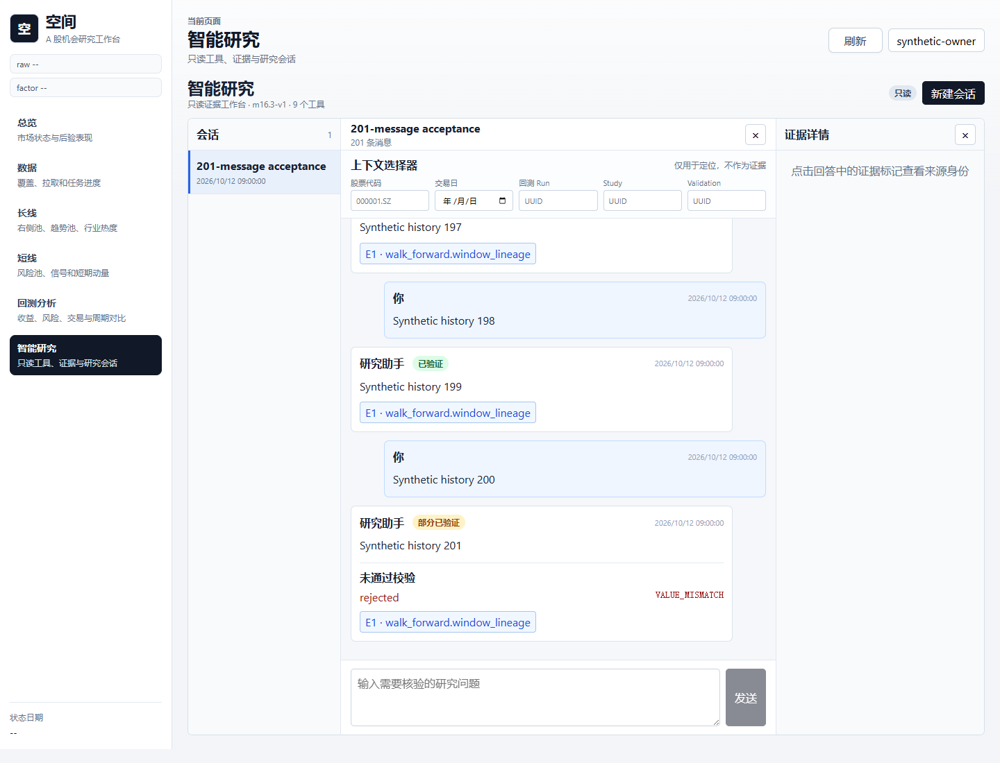
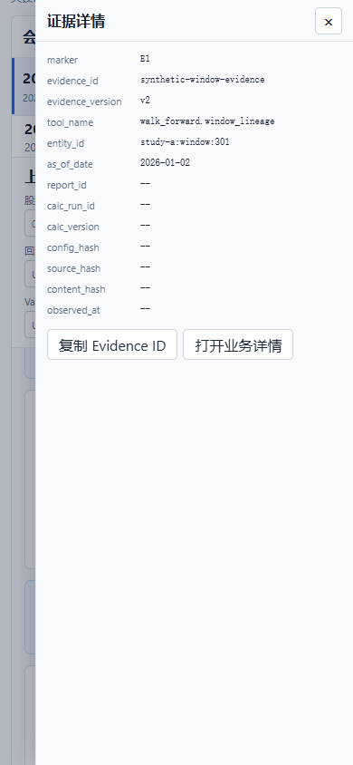

# M16.3.1 智能研究工作台可靠性验收

开发基线：`65a9b597a2aaf8f16aef8ea855e87fa5ca8ec32f`，当前分支 `master`。
本轮修改工作台交互、受鉴权的轻量查询、Citation 导航元数据、测试和文档。
九个只读工具、Evidence v2 的校验、M13-M16.2.2 计算与持久化身份保持原有口径。
没有新增 Migration；数据库基线仍为 PostgreSQL 17，revision 为 `0049_m16_2_1_hash_name`。

## API 兼容表

| API | 原契约 | 本轮增量 |
| --- | --- | --- |
| `GET /api/v1/agent/chats/{chat_id}` | 升序 `offset/limit`，默认 100，最多 200 条 | 保持原默认顺序；新增 `latest=true` 和 `before_sequence>=1`；游标模式按最新记录向前取页，响应仍升序 |
| 同一接口的 `meta` | `limit/offset/total` | 追加 `has_more/next_cursor`；`next_cursor` 只供向前游标分页，旧 offset 模式为 NULL |
| 同一接口的 `data` | 会话及 `messages` | 追加可空 `active_turn`，用于恢复服务端运行中的轮次 |
| `GET /api/v1/agent/chats/{chat_id}/turns/{request_id}` | 无 | owner 校验后返回 RUNNING/COMPLETED/FAILED、原问题、安全错误码、消息 ID、时间及已完成回答；跨用户会话统一 404 |
| `POST /api/v1/agent/chats/{chat_id}/messages` | 同 chat/request_id 内容 hash 幂等 | 请求及服务端写入契约不变；前端重试复用同一 ID 与规范化原文 |
| Citation | 原有 Evidence 来源字段 | 追加可空 `navigation`；字段来自已经验证的 Tool record/identity，与模型自由文本无关 |
| `GET /api/v1/portfolio/walk-forwards/{study_id}/validations/{validation_id}/windows` | `limit/offset` | 可选 `window_no>=1` 精确过滤；不传参数时行为不变，原有 Study/Validation 校验保留 |

游标模式在 `latest=true` 或提供 `before_sequence` 时生效，`offset` 此时不参与分页。
GET Turn 不触发模型、工具执行、数据任务或新的消息写入。COMPLETED 表示轮次完成，
内部回答仍可以是 COMPLETED、PARTIAL_VERIFIED 或 INSUFFICIENT_EVIDENCE。

## 请求恢复

1. 用户提交时创建唯一 `PendingSend`，绑定 chatId、requestId、规范化完整内容及时间；规范化沿用服务端的 NFKC、换行和行尾空白口径。
2. 网络错误、客户端传输超时或代理 5xx 没有可靠业务错误码时，进入 UNKNOWN_RESULT，先查询原 Turn。
3. 查回的 chatId/requestId 和问题正文必须匹配原请求；匹配后 COMPLETED 只读取历史回答，RUNNING 显示状态并有限轮询，FAILED 显示安全错误码。不同正文不能被误认为同一个完成请求。
4. Turn 尚未入库且当前页面保留原文时，人工点击“沿用原请求重试”先查询，再用原 ID/原文提交。
5. 422、IDEMPOTENCY_CONFLICT、LLM_DISABLED、总 Deadline、工具超时等明确拒绝不会自动重放。
   CHAT_CONFLICT 会查询原 Turn；若查询本身失败，只提供状态刷新，不开放原请求重放。
6. 明确 FAILED 可以通过“作为新消息重试”恢复完整多行问题，再由用户显式发送新 ID。

浏览器只在当前标签页的 sessionStorage 保存按登录用户分区的
`chatId/requestId/state/createdAt`，有效期 24 小时。正文、Evidence、Key 和 Cookie 均不写入该记录。
刷新时会先读取服务端 `active_turn`，再对保存的请求身份查询。保存的未知请求尚未找到或查询断网时，
保留 UNKNOWN_RESULT 并阻止第二次提交；如果服务端从未接收原文，刷新后的浏览器不能恢复其正文，
因此只允许刷新状态，不会用空正文或猜测内容重发。

自动轮询每 2 秒一次，每个请求最多 12 次；隐藏标签页、离开工作台和卸载时停止。
达到上限仍保留 RUNNING，并提供人工刷新。发送状态、异步错误、草稿、历史页缓存和滚动位置均按 chatId 隔离。
归档待处理会话的按钮禁用，服务端原有 RUNNING 归档门禁继续生效。

## 历史与导航

- 首次打开会话读取最新 50 条；更早消息使用 `sequence_no < before_sequence`，按 sequence_no 去重。
- 前插保留视窗锚点；新回复只有在读者仍位于底部时才自动滚动。缓存旧页与新回复之间存在空隙时，
  从服务端游标继续补全，不因缓存的最早序号而漏掉中间记录。
- Backtest/Performance 按明确 run_id 定位；即使 Run 不在最近 200 条列表，也会查询该 Run。
  不存在、不成功或缺少分析 Artifact 时明确报错，不选择其他 Run。
- Window 使用明确 Study/Validation/Window，并通过 `window_no` 精确查询，能够定位第 301 个窗口。
- 股票与行业定位同时核对实体及交易日；当前页日期与证据不一致时显示降级说明，不高亮为同日结果。
- 旧 Citation 没有 navigation、缺少必要字段或目标页不支持该定位时，提示“该证据暂不支持精准定位”。
- Evidence 详情仅显示固定来源字段；Vue 文本插值不会执行任意 HTML；拒绝 Claim 仅显示 ID 和安全原因码。

## 可复现验收数据

后端测试 `tests/integration/test_m16_2_agent_chat.py` 自动生成随机测试用户与会话，覆盖
0、1、199、200、201、1001 条消息，执行分页、全历史无重复、旧 offset 兼容和 EXPLAIN。
PostgreSQL 查询使用既有 `uq_agent_chat_message_sequence(session_id, sequence_no)` 索引。
并发测试用 FakeLLMProvider 阻塞首个请求，验证相同请求竞争、完成后的幂等回放、一个 Turn、两条消息及一次模型调用。
测试只清理由测试生成的随机身份，不清理用户业务表。

```bash
python -m pytest tests/unit/test_m16_2_agent_chat_api.py tests/unit/test_m16_3_1_navigation.py tests/integration/test_m16_2_agent_chat.py
```

前端 Vitest 使用可重复的 201 条消息和可控 Promise；覆盖响应丢失前/后提交、原 ID 重试、跨会话迟到响应、
前插锚点、分页期间新增消息、三态、401/409、关闭模型、Deadline、工具超时、刷新恢复、用户隔离与轮询上限。

```bash
cd frontend
npm ci
npm run test:coverage
npm run build
```

`scripts/verify_m16_3_1_workbench.mjs` 是可选浏览器验收脚本。使用本地 Vite、Node 22 和 Playwright；
Playwright 可安装在独立的工具目录，通过 `PLAYWRIGHT_MODULE_PATH` 指向其 `index.mjs`。
安装 Chromium 后直接运行，或用 `PLAYWRIGHT_BROWSER_CHANNEL=chrome` 使用本机 Chrome。
`WORKBENCH_URL` 可覆盖默认本地 URL，不需要配置真实模型 Key。

```bash
node scripts/verify_m16_3_1_workbench.mjs
```

脚本拦截全部 API，使用 201 条合成历史、Study/Validation/Window 301 和合成股票日期。
分别模拟“请求发送前断线”和“已提交、响应丢失”，断言 request_id 一致、已完成请求只有一个 POST、
全部历史无重复、窗口精确定位、实体/日期定位、返回草稿和滚动位置、输入框未被裁剪、手机无横向溢出。
没有真实登录、模型调用或数据库写入。

桌面和手机截图：





## 验证记录

环境：Python 3.12.11、PostgreSQL 17.7、Node 22.23.3、Vue 3/Vite 5；浏览器使用本机 Chrome 的 headless 模式。

| 检查 | 结果 |
| --- | --- |
| 后端全量 `python -m pytest --cov=backend/app --cov-report=term --cov-fail-under=70` | 1063 passed、0 skipped，7 个框架弃用提示；覆盖率 86.36%，通过 70% gate |
| `ruff check backend tests migrations scripts` | 通过 |
| `npm ci` | 通过；本机原 Vite 占用 native module，停止项目 Vite 后使用 Node 22 重装成功 |
| 前端 `npm run test:coverage` | 66 passed、0 skipped；总行覆盖率 79.17%，工作台 89.03% |
| 前端类型检查和 `npm run build` | `vue-tsc -b` 与 Vite build 均通过；保留原有 700 KiB 大包提示 |
| Playwright 桌面 1440/手机 390 | 最终版本通过；201 条历史、响应丢失前后提交、原 ID、Window 301、股票日期定位、返回草稿/滚动、输入框可见、无手机横向溢出；0 浏览器异常 |
| Alembic current / heads | 均为 `0049_m16_2_1_hash_name`；无新迁移，不执行 downgrade |
| `git diff --check` | 通过 |

本轮本地验收完成。前端已在 `http://127.0.0.1:5173/` 启动，本轮 Backend 在 `127.0.0.1:9035`，
因为已有进程占用 9034；本次 Vite 进程使用临时 `VITE_API_PROXY_TARGET` 指向 9035，未改写 `.env`。
已验证新增 Turn 路由在未登录时通过 Vite 代理返回 `401 UNAUTHORIZED`。
正常部署仍使用 README 原有端口配置，根据需要停止旧服务后重启新代码。

本轮实现提交 `b9f66b29d56922ba1a956f00bc1fb4d819dbf31f` 的
[CI #69](https://github.com/sssssssssh/ssh_stock/actions/runs/38219497949)
在前端滚动位置测试失败。原因是 `scrollTo({ behavior: "smooth" })` 会在用户已经向上滚动后延迟覆盖其位置。
修复提交 `471781a5490cfa55fd23a42bd5d843c807409bbb` 改为即时滚动，并增加延迟后仍保留阅读位置的断言；
[CI #70](https://github.com/sssssssssh/ssh_stock/actions/runs/38222565677) 结论 success。
桌面/手机浏览器验收已重跑，截图在证据抽屉完全展开后生成，并检查移动端操作按钮未被裁切。

## Checklist

| 任务书项 | 本轮验证 |
| --- | --- |
| T01 请求幂等与断线重试 | 本地通过：原 ID/原文重试；完成后找回；并发唯一 Turn/回答/LLM；冲突保持 hash 校验 |
| T02 最新页和全部历史 | 本地通过：0/1/199/200/201/1001、keyset、旧 offset、去重、前插位置、新增回复、索引 |
| T03 精准证据定位 | 本地通过：结构化 Window/Run/实体/日期；旧证据、不存在目标与日期不一致明确降级 |
| T04 状态恢复 | 本地通过：401/409/超时/禁用/离线；刷新、切换、归档限制、有限轮询、三态和失败展示 |
| T05 测试和交付 | 通过：本地完整验证、复现脚本、截图与文档；修复提交的远端 CI #70 success |

## 问题与回滚

- 保留已有大包警告（Vite 的 700 KiB chunk 提示）和测试框架的弃用提示；没有通过修改阈值或跳过测试消除提示。
- 刷新前从未入库的原问题不保存在浏览器，不能恢复正文；未知身份会保留且禁止空内容重放。先确认服务端状态。
- 本轮未启动 Docker/Compose 验证，部署配置与依赖锁没有修改。
- 常规回滚：停止本轮 Backend/Frontend，重新部署基线 `65a9b59` 的镜像或源码，并重启服务。
  不执行数据库 downgrade、删除会话或数据回填；新增导航只是既有 JSON 元数据的可选字段，旧代码可忽略。
- 应在 RUNNING Turn 结束后进行版本切换。关闭 LLM 仍可查看历史与查询 Turn 状态，默认开关未改变。
